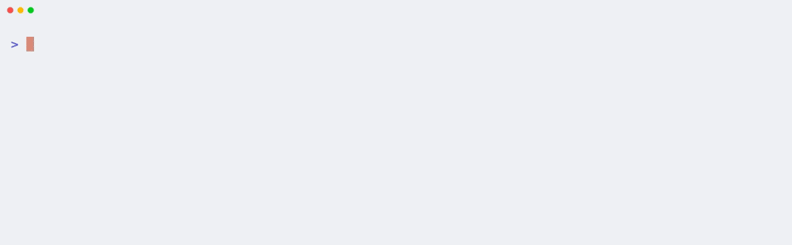

<!-- language-check: allow — public Korean README -->
<div align="center">

# tmux-llm-rescue

tmux가 비정상 종료된 뒤 Claude Code, Codex, Kimi 세션을 복구하는 명령줄 도구입니다.

[English](README.md) · Python 3.9+ · macOS 및 Linux

[](LICENSE)

[설치](#설치) · [빠른 시작](#빠른-시작) · [명령과 설정](#명령과-설정) · [제한](#제한)

</div>

<p align="center">
  <picture>
    <source media="(prefers-color-scheme: dark)" srcset="https://raw.githubusercontent.com/elfenomenokim/tmux-llm-rescue/main/docs/demo/rescue-dark.gif">
    
  </picture>
</p>

## 설치

아래 두 명령 중 하나를 실행하세요.

```sh
pipx install tmux-llm-rescue
uv tool install tmux-llm-rescue
```

tmux와 복구하려는 세션의 CLI가 필요합니다. 복구 도구는 로컬 파일을 읽고 기존 CLI를 실행합니다. 도구 자체는 계정, API 키, 인터넷 연결 없이 작동합니다.

## 빠른 시작

세션이 열린 tmux에서 실행하세요. 아래 예시에는 pane이 두 개 있습니다.

```console
$ tmux-llm-rescue record
Recorded 2 pane(s).
```

주기적으로 기록하려면 `~/.tmux.conf`에 다음 줄을 추가하세요. tmux 클라이언트가 연결된 동안 기존 상태 표시줄 갱신 주기에 맞춰 실행됩니다. tmux 서버의 PATH가 셸과 다르면 실행 파일의 절대 경로를 사용하세요.

```tmux
set -ag status-right '#(TMUX=#{q:socket_path},0,0 tmux-llm-rescue record >/dev/null)'
```

tmux가 종료되면 기록을 남긴 소켓을 지정해 실행하세요. 기본 소켓은 `-L work`를 빼면 됩니다.

```sh
tmux-llm-rescue -L work
tmux-llm-rescue restore -L work --dry-run
tmux-llm-rescue restore -L work --only 1,2
```

첫 명령은 세션 번호와 재개 명령을 표시합니다. 두 번째 명령은 새로 열릴 세션과 창, 작업 디렉터리, 실행할 명령을 보여줍니다. 세 번째 명령은 1번과 2번 세션만 엽니다. 이미 실행 중이거나 어느 pane에 속했는지 불분명한 세션은 건너뜁니다.

## 명령과 설정

| 명령 | 동작 |
| --- | --- |
| `tmux-llm-rescue [--json]` | 로컬 세션을 검색합니다. JSON에는 번호, 재개 명령, 기록과 일치한 pane이 포함됩니다. |
| `tmux-llm-rescue record` | 선택한 서버의 세션, 창, pane, 작업 디렉터리, 명령 이름, 기록 시각을 저장합니다. |
| `tmux-llm-rescue restore [--dry-run] [--only N,M]` | 일치한 세션을 새 창에 엽니다. 한 창의 여러 pane은 새 창에 타일 형태로 배치합니다. |
| `-L NAME` | 명령을 실행할 소켓을 지정합니다. tmux 안에서는 현재 소켓, 밖에서는 기본 소켓을 사용합니다. |
| `--since TIME`, `--lookback 12h` | 복구 기준 시각과 검색할 활동 범위를 지정합니다. `--since`에는 ISO 시각이나 `30m` 같은 상대 시간을 쓸 수 있습니다. |

기록은 소켓별로 `~/.local/state/tmux-llm-rescue/` 또는 `$XDG_STATE_HOME/tmux-llm-rescue/`에 저장됩니다. 서버가 재시작된 경우 재시작 직전의 마지막 기록을 사용합니다. 기록이 없어도 로컬 세션 목록은 볼 수 있습니다.

| CLI | 세션 저장 위치 | 재개 명령 |
| --- | --- | --- |
| Claude Code | `~/.claude` (`CLAUDE_CONFIG_DIR`) | `claude --resume {sid}` |
| Codex | `~/.codex` (`CODEX_HOME`) | `codex resume {sid}` |
| Kimi CLI | `~/.kimi` (`KIMI_SHARE_DIR`) | `kimi --resume {sid}` |
| Kimi Code CLI | `~/.kimi-code` | `kimi-code --session {sid}` |

이 기본값을 바꾸려면 `~/.config/tmux-llm-rescue/config.toml` 또는 `$XDG_CONFIG_HOME/tmux-llm-rescue/config.toml`을 만드세요. 검색할 저장 위치를 모두 지정하세요. 위치마다 `[[homes]]` 블록을 하나씩 쓰고 각 값을 따옴표로 묶으세요. CLI가 세션 ID를 받는 위치에 `{sid}`를 적으세요. 실행 파일이나 `env`로 시작하는 명령의 인수를 그대로 전달합니다.

```toml
[[homes]]
family = "codex"
root = "~/.codex-work"
resume_command = 'env CODEX_HOME=/home/user/.codex-work codex resume {sid}'
```

## 제한

- 기록에 세션 ID가 있으면 그 ID로 찾습니다. ID가 없으면 CLI와 작업 디렉터리가 양쪽에서 하나씩 일치해야 합니다. 오래됐거나 기록이 부족한 세션은 복구 명령에서 빠질 수 있습니다.
- 실행 인수에 세션 ID가 보이면 실행 중으로 표시합니다. 대상 서버에 ID를 확인할 수 없는 CLI가 있으면 같은 CLI와 디렉터리의 세션은 복구하지 않습니다. 다른 서버에서 새로 시작한 CLI의 ID는 보이지 않을 수 있습니다.
- 새 창이나 세션을 만들어 기록된 이름과 작업 디렉터리를 사용합니다. 일반 셸 pane은 건너뛰고 한 창의 여러 pane은 타일 형태로 새로 배치합니다.
- 해시 경로를 쓰는 Kimi CLI는 `kimi.json`의 작업 디렉터리 또는 일치하는 pane 기록이 필요합니다. 로컬 저장소를 대상으로 하며 Antigravity 및 원격 대화는 지원 범위 밖입니다.
- 원본 서버가 실행 중일 때 기록할 수 있습니다. 클라이언트가 연결되지 않은 서버는 스케줄러에서 `record -L NAME`을 실행하세요.

[tmux-resurrect](https://github.com/tmux-plugins/tmux-resurrect)는 일반 프로그램과 pane 배치를 복원합니다. [tmux-continuum](https://github.com/tmux-plugins/tmux-continuum)은 주기적 저장과 자동 시작을 추가합니다. [tmuxinator](https://github.com/tmuxinator/tmuxinator)는 설정 파일로 작업 공간을 재현합니다. 이 도구는 CLI의 로컬 저장소에서 세션 ID를 읽어 사용자가 지정한 세션을 엽니다.

테스트는 `python -m unittest discover -s tests -v`로 실행합니다. [기여 안내](CONTRIBUTING.md)

MIT 라이선스. [라이선스](LICENSE)

이 프로젝트는 Anthropic, OpenAI, Moonshot AI와 관계가 없습니다.
