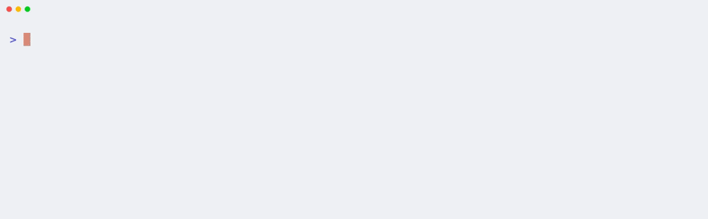

<div align="center">

# tmux-llm-rescue

A command-line tool for recovering Claude Code, Codex and Kimi sessions after a tmux crash.

[한국어](README.ko.md) · Python 3.9+ · macOS and Linux

[](LICENSE)

[Install](#install) · [Quick start](#quick-start) · [Reference](#reference) · [Limits](#limits)

</div>

<p align="center">
  <picture>
    <source media="(prefers-color-scheme: dark)" srcset="https://raw.githubusercontent.com/elfenomenokim/tmux-llm-rescue/main/docs/demo/rescue-dark.gif">
    
  </picture>
</p>

## Install

```sh
pipx install tmux-llm-rescue
uv tool install tmux-llm-rescue
```

Choose either command. You need tmux and the assistant CLI whose sessions you want to recover. The recovery tool reads local files and uses the CLI you already have. It needs no account, API key or network connection of its own.

## Quick start

Run this inside a tmux server while your assistant panes are open. The example server has two panes.

```console
$ tmux-llm-rescue record
Recorded 2 pane(s).
```

To record periodically, append this line to `~/.tmux.conf`. It uses your existing status interval while a tmux client is attached. Use the full path to your executable if the tmux server's PATH differs from your shell's.

```tmux
set -ag status-right '#(TMUX=#{q:socket_path},0,0 tmux-llm-rescue record >/dev/null)'
```

After a crash, run these commands for the same socket. Drop `-L work` for the default socket.

```sh
tmux-llm-rescue -L work
tmux-llm-rescue restore -L work --dry-run
tmux-llm-rescue restore -L work --only 1,2
```

The first command prints numbered sessions and resume commands you can paste. The second previews the new sessions, windows, working directories and commands. The third launches just rows 1 and 2. Running sessions and ambiguous matches are skipped.

## Reference

| Command | Behavior |
| --- | --- |
| `tmux-llm-rescue [--json]` | Scan local session stores. JSON includes row numbers, resume commands and recorded pane matches. |
| `tmux-llm-rescue record` | Save the selected server's session, window, pane, working directory, command name and time. |
| `tmux-llm-rescue restore [--dry-run] [--only N,M]` | Create new windows for matched sessions. Multiple recovered panes from a window share a new tiled window. |
| `-L NAME` | Select a named socket for any command. Inside tmux, the caller's socket is used by default. Outside tmux, the default socket is used. |
| `--since TIME`, `--lookback 12h` | Set a crash time (ISO time or an offset such as `30m`) and the activity window for scan or restore. |

Snapshots are kept per socket under `~/.local/state/tmux-llm-rescue/`, or under `$XDG_STATE_HOME/tmux-llm-rescue/`. When a server has restarted, recovery selects the last recording from before its startup. Without a snapshot, scan still lists local candidates.

The built-in homes are:

| CLI | Session root | Resume command |
| --- | --- | --- |
| Claude Code | `~/.claude` (`CLAUDE_CONFIG_DIR`) | `claude --resume {sid}` |
| Codex | `~/.codex` (`CODEX_HOME`) | `codex resume {sid}` |
| Kimi CLI | `~/.kimi` (`KIMI_SHARE_DIR`) | `kimi --resume {sid}` |
| Kimi Code CLI | `~/.kimi-code` | `kimi-code --session {sid}` |

To replace the defaults, create `~/.config/tmux-llm-rescue/config.toml` or `$XDG_CONFIG_HOME/tmux-llm-rescue/config.toml`. List every home to scan. Use one `[[homes]]` block per home and quote each field. Put `{sid}` wherever the CLI expects its ID. The tool passes the template as arguments and accepts an executable or an `env` prefix.

```toml
[[homes]]
family = "codex"
root = "~/.codex-work"
resume_command = 'env CODEX_HOME=/home/user/.codex-work codex resume {sid}'
```

## Limits

- Restore uses the recorded ID when present. Otherwise it requires one matching CLI and working directory on each side. Older, missing or ambiguous session data can leave a pane unmatched.
- An explicit session ID in a process's command line marks it as running. On the target server, a live assistant pane with an unknown ID blocks restore of a matching CLI and directory. A fresh CLI on another server may have no ID visible to this tool.
- Restore creates new windows or sessions. It recovers the recorded names and directories. It skips ordinary shell panes and uses a fresh tiled arrangement for multiple recovered panes in a window.
- The Kimi CLI's hashed layout needs a working-directory entry in `kimi.json` or a matching recorded pane. The scanners cover local storage. Antigravity and remote conversation stores are outside the package.
- The recorder needs a running source server. The status-line job runs while a client displays the status line. For detached servers, invoke `record -L NAME` from your scheduler.

[tmux-resurrect](https://github.com/tmux-plugins/tmux-resurrect) covers exact pane layouts and general programs. [tmux-continuum](https://github.com/tmux-plugins/tmux-continuum) adds periodic saving and automatic startup. [tmuxinator](https://github.com/tmuxinator/tmuxinator) starts repeatable workspaces from a configuration file. This tool reads assistant session IDs from local CLI stores and offers an explicit restore command.

Contributions are welcome. Run `python -m unittest discover -s tests -v`. [Contributing](CONTRIBUTING.md)

MIT license. [License](LICENSE)

This project is independent of Anthropic, OpenAI and Moonshot AI.
